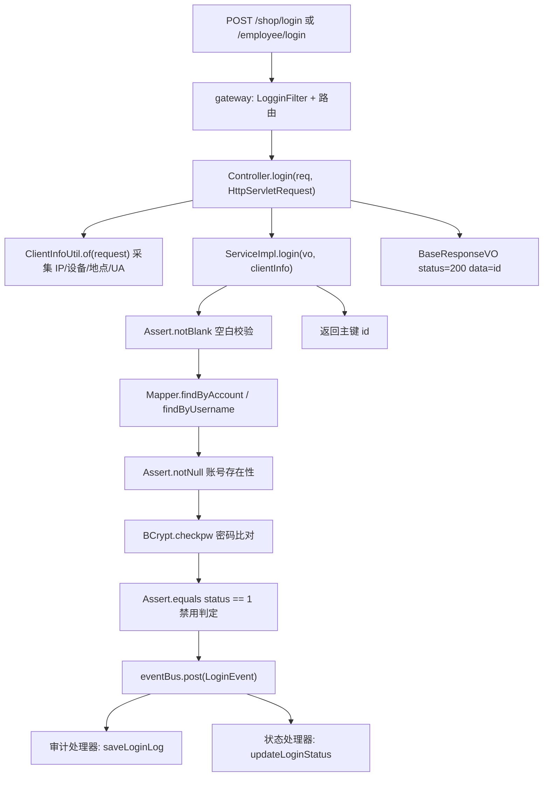
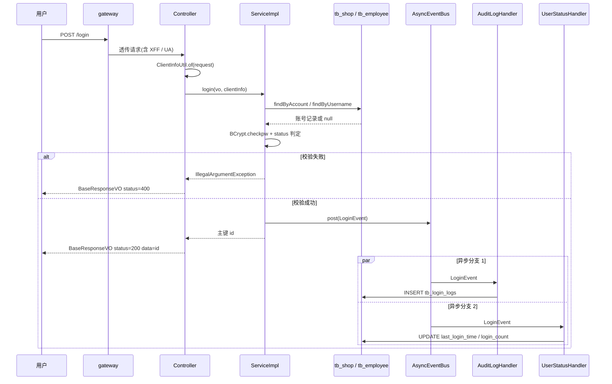
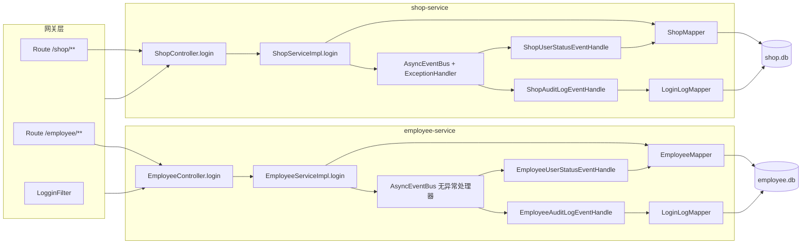

# TDD 任务拆解：店铺管理员 / 员工用户名密码登录

> 本文按 TDD 工作流把「用户使用用户名密码登录」拆解为**可直接指导写测试**的任务项。
> 拆解链路严格为：需求 → 功能点 → 功能上下文 → 任务项 → 测试思路。
> 执行原则：先让任务项对应的测试变红（Fail），再写最小实现使其变绿（Pass），最后重构。
> 本文与 [注册拆解](./shop-register-tdd-breakdown.md) 共用同一测试基座与命名约定，任务项编号可回溯。

## 目录

- [1. 需求概述](#1-需求概述)
- [2. 现有架构分析](#2-现有架构分析)
- [3. 功能点总览](#3-功能点总览)
- [4. 功能点拆解](#4-功能点拆解)
- [5. 架构与重构思考](#5-架构与重构思考)
- [附录 A：测试基础设施任务项](#附录-a测试基础设施任务项)
- [附录 B：任务项到测试类映射](#附录-b任务项到测试类映射)
- [附录 C：现状差异与红灯清单](#附录-c现状差异与红灯清单)
- [附录 D：范围外与后续候选需求](#附录-d范围外与后续候选需求)

---

## 1. 需求概述

在 B2C 电商系统中，用户使用「用户名 + 密码」完成登录：

1. 店铺管理员通过 `POST /shop/login`（账号 + 密码）登录；
2. 员工通过 `POST /employee/login`（用户名 + 密码 + 店铺 ID）登录；
3. 凭证正确时登录成功并返回该用户的业务主键 ID；
4. 凭证错误、账号被禁用、入参不合法时，用户得到明确且**不泄露账号是否存在**的反馈；
5. 登录成功后系统自动记录审计日志（IP / 设备 / 地点 / UA）并更新最后登录时间与累计登录次数。

### 1.1 需求澄清结论（交互式问答记录）

| 问题 | 结论 |
| --- | --- |
| 登录主体覆盖哪一侧 | **店铺管理员与员工两端对称覆盖**（两套 `login` 均为零测试） |
| 是否签发会话凭证 | **否，本次仅凭证校验**；返回业务主键 ID，Token / 会话留作后续独立需求 |
| 失败审计、失败次数锁定、验证码 | **本次范围外**，仅锁定现状（见附录 D） |
| View 层如何界定 | 仓库内无前端工程，以 **HTTP 接口契约 + 网关路由** 作为 View 层 |
| 测试技术栈 | JUnit 5 + Mockito + MockMvc（`standaloneSetup`）+ 手工 MyBatis + 文件型 SQLite |

### 1.2 范围边界

**本次范围内**：`/shop/login` 与 `/employee/login` 的主流程、入参校验、凭证比对（BCrypt）、
账号禁用判定、失败语义与防账号枚举、登录成功事件、审计日志、登录状态更新（时间 / 次数）、
多店铺与多租户下的账号定位正确性、网关路由与过滤器可达性、测试基座补全。

**本次范围外**：Token / 会话签发与校验、网关鉴权与白名单、失败登录审计（`status=0`）、
连续失败锁定、验证码、密码找回、SSO / 第三方登录、前端页面。

---

## 2. 现有架构分析

### 2.1 服务与职责清单

| 模块 | 类型 | 关键职责（与登录相关） |
| --- | --- | --- |
| `gateway` | 接入层 | Spring Cloud Gateway，`/shop/**` → `lb://shop-service`，`/employee/**` → `lb://employee-service` |
| `shop` | 业务服务 | 店铺管理员登录 `/shop/login`，持有 `shop.db`，发布 `ShopLoginEvent` |
| `employee` | 业务服务 | 员工登录 `/employee/login`，持有 `employee.db`，发布 `EmployeeLoginEvent` |
| `common` | 公共模块 | `BaseResponseVO`、`BizException`、`ClientInfo`、`ClientInfoUtil` |
| `product` / `order` | 业务服务 | 与本次登录需求无直接关系（`product` 仅有一个空的 `TokenFilter` 壳） |

### 2.2 单个服务内的分层（MVC 视角）

| 分层 | 登录链路中的组件 |
| --- | --- |
| 接入层（View 的前置） | `LogginFilter`（`GlobalFilter`，仅打日志）、`application.yml` 路由 |
| View 层（HTTP 契约） | `ShopLoginRequestVO` / `LoginRequestVO` + Bean Validation、`BaseResponseVO` 响应结构 |
| Controller 层 | `ShopController#login`、`EmployeeController#login`（同时采集 `ClientInfo`） |
| Service 层 | `ShopServiceImpl#login`、`EmployeeServiceImpl#login` |
| Model/DAO 层 | `ShopPO`/`ShopMapper`（`findByAccount`、`updateLoginStatus`）、`EmployeePO`/`EmployeeMapper`（`findByUsername`） |
| 审计模型 | `LoginLogPO`/`LoginLogMapper#saveLoginLog`，表 `tb_login_logs` |
| 事件/集成层 | `EventBus`（`AsyncEventBus`）、`ShopLoginEvent` / `EmployeeLoginEvent`、四个 `@Subscribe` 处理器 |
| 横切层 | `MethodArgNotValidExceptionAspect`（shop）、`GlobalExceptionHandler`（employee）、`EventBusExceptionHandler`（仅 shop 装配） |

### 2.3 登录链路的组件协作

### 2.4 影响拆解的关键现状事实

| 编号 | 现状 | 对测试拆解的影响 |
| --- | --- | --- |
| P1 | 登录只返回业务主键 `id`，不签发 Token / 会话（`product` 仅有空 `TokenFilter`，`employee` 已引 redis 依赖但无使用） | 「无凭证」需固化为契约锚点，避免被误判为缺陷；Token 属范围外 |
| P2 | `tb_shop` 只有 `uk_shop_shop_name` 唯一索引，`admin_account` 仅普通索引；注册也不校验账号唯一 | `findByAccount` 的 `LIMIT 1` 在同名账号下结果不确定 → **跨店铺串号**，必须红灯驱动 |
| P3 | `LoginRequestVO.shopId` 无 `@NotNull`，`findByUsername` 用 `<if test="shopId != null">` 动态忽略店铺条件 | 员工侧 `shopId` 传空即跨租户检索，是 **多租户越权** 红灯点 |
| P4 | 密码以 BCrypt 哈希入库，登录用 `BCrypt.checkpw` 明文比对 | 加密语义已具备，需用断言锁定；历史明文数据需兼容性用例 |
| P5 | 账号不存在与密码错误共用消息「账号或密码错误」，但禁用态消息独立（「店铺已被禁用」/「账号已被禁用」） | 防枚举方向正确但不彻底，需一条「响应完全一致」用例暴露禁用态泄露 |
| P6 | 登录链路业务错误仍用 hutool `Assert` 抛 `IllegalArgumentException`，未统一为 `BizException` | 异常类型即行为契约；与注册侧已重构的 `BizException` 不一致，属遗留坏味道 |
| P7 | 所有响应 HTTP 状态码恒为 200，业务码在 body | 断言必须查 body 的 `status`，不能查 HTTP 4xx |
| P8 | `ShopLoginRequestVO` 仅 `@NotBlank`（无 `@Length`）；员工侧 `LoginRequestVO` **零校验注解**，`@Validated` 形同虚设 | 超长入参可直达 BCrypt；V2 校验规则与注册侧不一致 |
| P9 | `ClientInfo` 由 Controller 注入，审计处理器直接解引用 `event.getClientInfo().getIp()` | Service 被直接调用（clientInfo 为 null）时异步线程 NPE，需红灯覆盖 |
| P10 | 登录成功事件在 Service 层发布（已按注册重构下沉），处理器用 `InitializingBean` 手动注册 | 断言点位置明确；未注册即静默丢失需被断言捕获 |
| P11 | shop 侧 `AsyncEventBus` 装配了 `SubscriberExceptionHandler`，**employee 侧未装配** | 员工侧订阅者异常只被 Guava 默认打印，不可观测 → 不对称红灯 |
| P12 | shop 侧 Advice 无通用 `Exception` 兜底；employee 侧无 `MethodArgumentNotValidException` 处理 | 未预期异常与校验异常都可能绕过 `BaseResponseVO` 契约 |
| P13 | 测试基座**不含** `tb_login_logs` 建表，且两个 DAO 基类都未解析 `LoginLogMapper.xml` | 审计链路当前无法被测，必须先补基座（附录 A） |
| P14 | `ShopPO` 未映射 `last_login_time` / `login_count`（`EmployeePO` 有） | 店铺侧登录状态只能原生 SQL 回读，两侧模型不对称 |

---

## 3. 功能点总览

| 功能点 | 用户可感知行为 | 主要功能上下文 | 优先级 |
| --- | --- | --- | --- |
| F1 凭证正确即可登录成功 | 输入正确用户名密码后登录成功并拿到身份 ID | View / Controller / Service / Model / 事件契约 | P0 |
| F2 凭证错误被拒绝且不泄露账号存在性 | 密码错误或账号不存在时收到统一提示 | Controller / Service / Model | P0 |
| F3 账号被禁用时不能登录 | 被停用的账号无法登录并收到明确提示 | Service / Model / Controller | P0 |
| F4 登录成功后自动记录审计日志 | 安全审计中可查到 IP / 设备 / 地点 / UA | 事件订阅者 / Model-DAO / ClientInfoUtil | P0 |
| F5 登录成功后更新最后登录时间与次数 | 后台可见「最后登录时间」与「累计登录次数」 | 事件订阅者 / Model-DAO | P1 |
| F6 多店铺 / 多租户下登录精确定位唯一账号 | 同名账号不会登录到别的店铺 | Service / Model-DAO / 数据层约束 | P0 |
| F7 登录请求可通过网关统一入口访问 | 通过网关地址即可完成登录 | 网关路由 / 网关过滤器 | P1 |

---

## 4. 功能点拆解

### 功能点 1：用户提交正确的用户名与密码即可登录成功

**用户可感知行为**：携带正确的账号与密码调用登录接口，返回业务码 200 与自己的身份 ID。

> 两侧对称说明：shop 侧端点为 `POST /shop/login`，字段 `adminAccount` / `adminPassword`；
> employee 侧端点为 `POST /employee/login`，字段 `username` / `password`（另有 `shopId`）。
> 下列任务项除标注「仅 shop」/「仅 employee」外，均要求用参数化用例两端各跑一遍。

#### 功能上下文 1.1：View 层 - 登录 HTTP 接口契约

- **任务项 1.1.1**：`POST /shop/login` 与 `POST /employee/login` 接受 `application/json` 请求体
  - *测试思路*：MockMvc 发送合法 JSON，断言响应 HTTP 200 且 body `status=200`；
    边界：用表单编码（`application/x-www-form-urlencoded`）发送时不得返回业务成功码
- **任务项 1.1.2**：请求字段名与 VO 属性严格对应
  - *测试思路*：断言反序列化后 `adminAccount`/`adminPassword`（shop）与 `username`/`password`/`shopId`（employee）等于请求值；
    边界：下发下划线格式（`admin_account`）必须映射不上并落到校验失败
- **任务项 1.1.3**：成功响应结构为 `BaseResponseVO`（`status`/`message`/`data`）
  - *测试思路*：断言 body 含三字段且 `status=200`；
    边界：断言 HTTP 4xx/5xx 的写法必须失败（业务码走 body，P7）
- **任务项 1.1.4**：成功响应 `data` 为业务主键 ID（现状契约锚点，P1）
  - *测试思路*：mock service 返回 100，断言 `data == 100` 且为整数；
    边界：断言 `data` 是 Token 字符串的用例应当失败（本期不签发凭证）
- **任务项 1.1.5**：仅 `POST` 命中登录端点
  - *测试思路*：断言 POST 返回 200；
    边界：`GET /shop/login` 必须 405，`POST /shop/logins` 必须 404
- **任务项 1.1.6**：登录接口不要求任何自定义请求头即可成功
  - *测试思路*：不携带 `Authorization`/`X-Forwarded-For`/`User-Agent` 调用，断言仍返回 `status=200`；
    边界：缺少 `User-Agent` 时不得 500（审计降级为「未知」）

#### 功能上下文 1.2：Controller 层 - 登录请求编排与客户端信息采集

- **任务项 1.2.1**：将请求 VO 原样传给 `shopService.login` / `employeeService.login`
  - *测试思路*：`@MockBean` 后 `verify(service).login(same(vo), any())`；
    边界：参数被重新构造导致 `same` 失败即缺陷
- **任务项 1.2.2**：Controller 从 `HttpServletRequest` 构造 `ClientInfo` 并传入 Service
  - *测试思路*：请求带 `X-Forwarded-For` 与 `User-Agent`，`ArgumentCaptor` 捕获 `ClientInfo` 断言四字段来源；
    边界：传入 `null` 或在 Controller 内自行拼字符串都视为缺陷
- **任务项 1.2.3**：`clientInfo` 非空且四个字段均被填充
  - *测试思路*：断言 `ip`/`device`/`location`/`userAgent` 均非 null；
    边界：`userAgent` 为 null 时 `device` 必须回落为「未知」而非 null
- **任务项 1.2.4**：Service 返回 ID 时回填成功响应
  - *测试思路*：mock service 返回 7，断言 body `status=200` 且 `data=7`；
    边界：service 抛异常时不得返回 200
- **任务项 1.2.5**：Service 抛 `BizException` 时按异常 `code` 转为业务码
  - *测试思路*：mock 抛 `BizException.badRequest("xxx")`，断言 `status=400` 且 message 一致；
    边界：`code=500` 的异常必须返回 500，不得一律压成 400
- **任务项 1.2.6**：Service 抛 `IllegalArgumentException` 时转为业务码 400 且保留原消息
  - *测试思路*：mock 抛「账号或密码错误」，断言 `status=400` 且 message 完全一致；
    边界：消息被改写为「内部错误」必须失败
- **任务项 1.2.7**：VO 校验失败时返回 400 且不进入 Service（仅 shop，P8）
  - *测试思路*：两个字段置空，断言 `status=400` 且 `verify(service, never()).login(any(), any())`；
    边界：校验失败仍调用 Service 说明校验时机过晚
- **任务项 1.2.8**：employee 侧缺少 `MethodArgumentNotValidException` 处理器 ⚠️ 红灯（P12）
  - *测试思路*：给 `LoginRequestVO` 加约束后发送非法请求，断言响应体仍是 `BaseResponseVO` 且 `status=400`；
    边界：当前 `GlobalExceptionHandler` 未覆盖该异常，用例必红，驱动补处理器
- **任务项 1.2.9**：未预期异常存在兜底响应契约 ⚠️ 红灯（P12，仅 shop）
  - *测试思路*：mock service 抛 `RuntimeException`，断言 body `status=500` 且结构为 `BaseResponseVO`；
    边界：当前无通用 `Exception` 兜底，用例必红，驱动补 `handleException`

#### 功能上下文 1.3：Service 层 - 凭证校验编排

- **任务项 1.3.1**：空白账号先被拒绝且不查库
  - *测试思路*：传 `null`/`""`/`"  "` 三种输入，断言抛异常且 `verify(mapper, never()).findBy*`；
    边界：`"  "` 必须被 `notBlank` 语义拒绝（`notNull` 会放行）
- **任务项 1.3.2**：空白密码先被拒绝且不查库
  - *测试思路*：同上断言「账户密码不能为空」/「账号密码不能为空」；
    边界：仅空格时不得进入 BCrypt 比对
- **任务项 1.3.3**：用账号查询唯一记录
  - *测试思路*：mock `findByAccount`/`findByUsername` 返回记录，`verify` 调用一次且入参为请求账号；
    边界：入参被 trim 或大小写归一化必须显式化并同步断言
- **任务项 1.3.4**：用 `BCrypt.checkpw` 比对明文密码与库中哈希
  - *测试思路*：库中存 `BCrypt.hashpw("123456")`，断言登录成功；
    边界：把密文当明文再哈希一次比较的写法必须失败
- **任务项 1.3.5**：密码比对为大小写敏感的精确匹配
  - *测试思路*：库中密码为 `Abc123`，用 `abc123` 登录断言失败；
    边界：`abc123` 成功说明发生了大小写归一化，属缺陷
- **任务项 1.3.6**：密码列非 BCrypt 格式时不抛未受控异常 ⚠️ 红灯（P4 兼容性）
  - *测试思路*：库中存历史明文 `123456`，断言响应为统一的凭证错误而非 `Invalid salt version`；
    边界：当前 `BCrypt.checkpw` 会抛异常，用例必红，驱动兼容或数据校验
- **任务项 1.3.7**：校验全部通过后发布登录事件
  - *测试思路*：`ArgumentCaptor` 捕获 `eventBus.post` 参数并断言类型为 `ShopLoginEvent`/`EmployeeLoginEvent`；
    边界：任何校验未过就发布事件必须被判失败
- **任务项 1.3.8**：事件字段完整且与库中记录一致
  - *测试思路*：断言 `shopId`（employee 为 `employeeId`）、`shopName`、`adminAccount`/`username`、`clientInfo`；
    边界：`clientInfo` 为 null 或字段互换必须失败
- **任务项 1.3.9**：`clientInfo` 为 null 时 Service 仍可返回成功（P9 前置）
  - *测试思路*：直接调用 service 传 `null`，断言返回 ID 且事件已发布；
    边界：Service 不得因为 `clientInfo` 为空而 NPE（NPE 发生在订阅者侧，见 4.1.6）
- **任务项 1.3.10**：查询异常向上传播而不被吞掉
  - *测试思路*：mock mapper 抛 `DataAccessException`，断言异常穿透到调用方；
    边界：被 catch 后返回 null 或 0 会被误判为「账号不存在」
- **任务项 1.3.11**：登录成功后返回库中主键 ID（而非入参或事件中的副本）
  - *测试思路*：断言返回值等于 `findByAccount` 返回对象的 `id`；
    边界：返回 `null`（如 `ShopPO.id` 未映射）必须视为缺陷

#### 功能上下文 1.4：Model/DAO 层 - 账号查询

- **任务项 1.4.1**：`findByAccount` 按 `admin_account` 精确等值查询
  - *测试思路*：库中插入两条不同账号，断言查 `admin` 只返回 `admin` 那条；
    边界：返回 `admin2` 或前缀匹配（`LIKE`）必须失败
- **任务项 1.4.2**：`findByUsername` 按 `username` 等值查询（employee）
  - *测试思路*：同一店铺两条账号，断言各查各的；
    边界：`username` 为空串时必须查不到而不是返回第一条
- **任务项 1.4.3**：查询结果字段完整（`id`/`shopName`/`adminAccount`/`adminPassword`/`status`）
  - *测试思路*：插入后 `SELECT` 回读并逐字段断言；
    边界：任一别名字段未映射（如 `shop_name` 未 `AS shopName`）必须被断言捕获
- **任务项 1.4.4**：查询不存在的账号返回 `null` 而不是空对象
  - *测试思路*：空表查询断言 `isNull()`；
    边界：返回 new 空对象会让「账号不存在」判定失效
- **任务项 1.4.5**：账号比较为大小写敏感（SQLite 默认 BINARY）
  - *测试思路*：库中 `Admin`，查 `admin` 断言 `null`；
    边界：该用例把当前敏感语义固化为契约，若改为忽略大小写需同步改断言与产品确认
- **任务项 1.4.6**：`ShopPO` 未映射 `last_login_time`/`login_count`（现状，P14）
  - *测试思路*：断言 `findByAccount` 的返回对象无这两个字段可读，登录状态只能原生 SQL 回读；
    边界：一旦补字段，该用例需同步改造，用红绿切换暴露模型变更
- **任务项 1.4.7**：`admin_account` 查询使用 `idx_shop_admin_account` 索引
  - *测试思路*：查 `EXPLAIN QUERY PLAN` 断言命中 `idx_shop_admin_account`；
    边界：索引被删除或查询改成 `LIKE` 导致全表扫描时该保护用例如期失败

#### 功能上下文 1.5：事件契约层 - 登录成功事件定义

- **任务项 1.5.1**：`ShopLoginEvent` 携带 `shopId`/`shopName`/`adminAccount`/`clientInfo`
  - *测试思路*：构造事件逐字段读写断言；
    边界：字段缺失或命名漂移（如 `adminAccount` 改名）必须失败
- **任务项 1.5.2**：`EmployeeLoginEvent` 携带 `employeeId`/`shopId`/`username`/`clientInfo`
  - *测试思路*：同上；
    边界：把 `employeeId` 与 `shopId` 混用必须失败（审计 `user_id` 会指向错误主体）
- **任务项 1.5.3**：两个事件类型不共享基类且不会互相订阅
  - *测试思路*：向同一 `EventBus` 分别投递两个事件，断言只有对应处理器被触发；
    边界：`ShopLoginEvent` 触发员工处理器即跨服务串号

---

### 功能点 2：凭证错误被拒绝且不泄露账号是否存在

**用户可感知行为**：密码错误或账号不存在时收到同一个提示，无法据此判断账号是否存在。

#### 功能上下文 2.1：View/Controller 层 - 失败响应契约

- **任务项 2.1.1**：失败响应 HTTP 状态仍为 200，业务码为 400
  - *测试思路*：断言 `status().isOk()` 且 `jsonPath("$.status").value(400)`；
    边界：出现 HTTP 401/403 说明有人改成 HTTP 语义，需同步网关与前端契约
- **任务项 2.1.2**：失败响应 `data` 为 null
  - *测试思路*：断言 `jsonPath("$.data").doesNotExist()` 或值为 null；
    边界：`data` 返回残留 ID 会误导前端建立会话
- **任务项 2.1.3**：失败消息不包含内部细节（堆栈、SQL、列名、类名）
  - *测试思路*：断言 message 既不包含 `SQLException` 也不包含 `UNIQUE`/`tb_shop`/`BCrypt` 等字样；
    边界：异常消息直出即信息泄露
- **任务项 2.1.4**：失败消息文案可读且与产品文案一致
  - *测试思路*：断言 message 等于「账号或密码错误」；
    边界：文案被改成英文或空串必须让用例失败以触发评审
- **任务项 2.1.5**：失败响应结构同样为 `BaseResponseVO`（不返回 HTML 错误页）
  - *测试思路*：断言 `Content-Type` 为 JSON 且含 `status` 字段；
    边界：返回 Spring 默认错误页（含 `timestamp`/`path` 字段）即契约破坏

#### 功能上下文 2.2：Service 层 - 凭证校验失败语义

- **任务项 2.2.1**：账号不存在时抛「账号或密码错误」且不发布事件
  - *测试思路*：mock `findByAccount` 返回 null，断言异常消息并 `verify(eventBus, never()).post(any())`；
    边界：抛出「账号不存在」会让攻击者枚举账号
- **任务项 2.2.2**：密码错误时抛「账号或密码错误」且不发布事件
  - *测试思路*：mock 返回记录但密码不匹配，断言异常消息与 `never()`；
    边界：密码错误却发布了登录事件会导致审计假记录
- **任务项 2.2.3**：两种失败的响应完全一致（防账号枚举，P5）
  - *测试思路*：分别构造「账号不存在」与「密码错误」，断言两次响应的 `status` 与 `message` 逐字节相同；
    边界：任何可区分差异（消息、状态码、耗时可忽略）都必须被标记为安全缺陷
- **任务项 2.2.4**：失败路径不产生任何写副作用
  - *测试思路*：断言 `verify(mapper, never()).updateLoginStatus`、`verify(loginLogMapper, never()).saveLoginLog`；
    边界：失败却刷新了 `last_login_time` 会污染运营数据
- **任务项 2.2.5**：密码为空串与密码错误走同一条失败语义
  - *测试思路*：传 `""` 断言抛「账号密码不能为空」，传错误值断言「账号或密码错误」；
    边界：两种失败若返回不同结构，防枚举断言 2.2.3 必须一并覆盖
- **任务项 2.2.6**：明文密码不出现在异常消息、日志与事件中
  - *测试思路*：用 Logback `ListAppender` 捕获日志，断言不含测试用的明文口令；
    边界：把 `vo.toString()` 直接打进日志即泄露（`ShopLoginRequestVO` 是 `@Data`，toString 含密码）

#### 功能上下文 2.3：Model/DAO 层 - 空结果与比对职责

- **任务项 2.3.1**：查询不到账号时返回 null，不抛异常
  - *测试思路*：空表调用 `findByAccount`，断言 `isNull()` 且不抛异常；
    边界：`resultType` 配置为一对多导致 `TooManyResultsException` 必须失败
- **任务项 2.3.2**：密码比对不发生在 SQL 层
  - *测试思路*：断言 mapper 接口无「按账号+密码查询」的方法或语句；
    边界：把明文密码拼进 SQL 会使 2.2.3 的防枚举失效并泄漏到慢查询日志

---

### 功能点 3：账号被禁用时不能登录

**用户可感知行为**：被停用的店铺或员工账号无法登录，且收到明确提示。

#### 功能上下文 3.1：Service 层 - 账号状态判定

- **任务项 3.1.1**：`status=0` 且密码正确时拒绝登录
  - *测试思路*：mock 返回 `status=0`，断言抛「店铺已被禁用」/「账号已被禁用」；
    边界：返回成功必须让用例失败
- **任务项 3.1.2**：`status=1` 时允许登录
  - *测试思路*：断言正常返回 ID；
    边界：把 `status` 语义颠倒（0 为启用）必须被断言捕获
- **任务项 3.1.3**：禁用账号不发布登录事件、不写审计、不更新登录状态
  - *测试思路*：断言 `verify(eventBus, never()).post(any())`；
    边界：禁用账号出现在审计日志会干扰安全分析
- **任务项 3.1.4**：状态判定发生在密码校验之后（顺序锚点）
  - *测试思路*：`status=0` 且密码错误，断言抛「账号或密码错误」而非「已被禁用」；
    边界：把状态判断提前会让禁用账号的密码错误信息可区分，破坏防枚举
- **任务项 3.1.5**：`status` 为 null 时按拒绝处理
  - *测试思路*：mock 返回对象 `status=null`，断言抛异常且不登录；
    边界：`Assert.equals(null, 1)` 依赖 hutool 的 `ObjectUtil.equal` 返回 false 才安全，需用例锁定
- **任务项 3.1.6**：禁用判定两侧语义与文案各自独立
  - *测试思路*：参数化断言 shop 侧为「店铺已被禁用」、employee 侧为「账号已被禁用」；
    边界：文案串用（员工侧提示「店铺已被禁用」）会让用例失败

#### 功能上下文 3.2：Model/DAO 层 - 状态字段读取

- **任务项 3.2.1**：`findByAccount`/`findByUsername` 返回 `status` 列
  - *测试思路*：插入 `status=0` 记录后查询断言返回 0；
    边界：SQL 漏选 `status` 会返回 null 并被 3.1.5 拒绝，属隐性故障
- **任务项 3.2.2**：建表默认 `status=1`
  - *测试思路*：不传 `status` 插入后断言为 1；
    边界：默认 0 会使新注册账号立即不可登录
- **任务项 3.2.3**：`status` 列类型与取值域明确（0/1）
  - *测试思路*：插入 2 或 -1 时断言行为（当前被放行，属范围外）；
    边界：该用例显式记录「无非法规值约束」这一现状

#### 功能上下文 3.3：安全语义 - 禁用提示与防枚举的冲突

- **任务项 3.3.1**：禁用态提示会泄露账号存在性 ⚠️ 决策点（P5）
  - *测试思路*：先探测不存在的账号，再探测存在的禁用账号，断言两者响应一致；
    边界：当前必然不一致，用例先红，驱动产品在「用户体验」与「防枚举」间做显式决策
- **任务项 3.3.2**：禁用提示的错误码仍为业务码 400
  - *测试思路*：断言 `status=400` 而非 403；
    边界：改用 403 需同步网关与前端，必须显式变更
- **任务项 3.3.3**：禁用账号与不存在账号的响应体结构一致（仅 message 不同）
  - *测试思路*：断言两者字段集与类型相同；
    边界：一个带 `data` 一个不带会让结构探测可行

---

### 功能点 4：登录成功后自动记录审计日志

**用户可感知行为**：安全审计中能查到本次登录的时间、IP、设备、地点与 UA。

#### 功能上下文 4.1：事件订阅者 - 审计日志处理器

- **任务项 4.1.1**：处理器随 Spring 容器启动注册到 `EventBus`
  - *测试思路*：断言 `afterPropertiesSet` 调用了 `eventBus.register(this)`；
    边界：未注册时审计静默缺失，必须被断言捕获
- **任务项 4.1.2**：`LoginEvent` 到 `LoginLogPO` 的字段映射正确
  - *测试思路*：捕获 `saveLoginLog` 入参，断言 `userId = 事件主键`、`userType=1`（shop）/ `userType=2`（employee）；
    边界：`userType` 串用会让店铺与员工审计混在同一命名空间
- **任务项 4.1.3**：IP / 设备 / 地点 / UA 四个字段来自 `clientInfo`
  - *测试思路*：构造 `clientInfo` 四字段为已知值，逐字段断言落库值；
    边界：任一字段与事件不一致（如 `ip` 写成了 `location`）必须失败
- **任务项 4.1.4**：审计记录 `status=1`（成功）
  - *测试思路*：断言 `po.status == 1`；
    边界：写成 0 会让成功登录被标记为失败（表语义为 1-成功 0-失败）
- **任务项 4.1.5**：落库影响行数必须为 1，否则抛异常
  - *测试思路*：mock `saveLoginLog` 返回 0，断言抛「保存登录审计日志失败」；
    边界：返回 1 必须正常返回；返回 null 时不得 NPE 后静默
- **任务项 4.1.6**：`clientInfo` 为 null 时不得 NPE ⚠️ 红灯（P9）
  - *测试思路*：直接调用 `handler(event)` 且 `event.clientInfo=null`，断言不抛 NPE（跳过审计或写「未知」）；
    边界：当前 `event.getClientInfo().getIp()` 必抛 NPE，用例先红
- **任务项 4.1.7**：订阅者异常可观测（shop 侧已有 `EventBusExceptionHandler`）
  - *测试思路*：注入自定义 `SubscriberExceptionHandler`，让处理器抛异常，断言异常处理器被调用且日志含事件信息；
    边界：无处理器的 `EventBus` 只打印到 stderr，视为不可观测
- **任务项 4.1.8**：employee 侧 `AsyncEventBus` 未装配异常处理器 ⚠️ 红灯（P11）
  - *测试思路*：断言 employee 的 `EventBus` Bean 持有非默认 `SubscriberExceptionHandler`；
    边界：当前未装配，用例必红，驱动两侧装配对称
- **任务项 4.1.9**：审计失败不影响主流程响应
  - *测试思路*：让 `saveLoginLog` 抛异常，断言登录接口仍返回 `status=200`；
    边界：主流程被异步审计异常拖垮必须失败

#### 功能上下文 4.2：Model/DAO 层 - `tb_login_logs` 持久化

- **任务项 4.2.1**：`INSERT` 覆盖 `user_id/user_type/login_ip/login_device/login_location/login_time/user_agent/status` 八列
  - *测试思路*：落库后原生 `SELECT` 断言八列取值；
    边界：`login_time` 由 `datetime('now','localtime')` 生成，必须非空
- **任务项 4.2.2**：主键回填到 `LoginLogPO.id`
  - *测试思路*：断言 `po.getId()` 非空且等于 `SELECT last_insert_rowid()`；
    边界：`useGeneratedKeys` 配置错误必须失败（当前无任何断言覆盖此点）
- **任务项 4.2.3**：`user_id` 的 NOT NULL 约束生效
  - *测试思路*：直插 `user_id=NULL` 断言 `SQLException`；
    边界：允许写入 NULL 说明约束缺失，审计将丢失主体
- **任务项 4.2.4**：`idx_login_logs_user_id` 与 `idx_login_logs_login_time` 索引存在
  - *测试思路*：查 `sqlite_master` 断言两个索引存在；
    边界：索引被删除时该回归用例如期失败
- **任务项 4.2.5**：测试基座缺少 `tb_login_logs` 与 `LoginLogMapper` 解析 ⚠️ 红灯（P13）
  - *测试思路*：断言两个 DAO 基类可获取 `LoginLogMapper` 且表存在；
    边界：当前必红，需在测试 schema 与基类中补齐（附录 A）
- **任务项 4.2.6**：失败登录的审计语义（`status=0`）已定义但未使用（范围外锚点）
  - *测试思路*：断言失败登录不产生任何 `tb_login_logs` 记录，把当前语义固定下来；
    边界：后续实现失败审计时该用例需改写，用红绿切换暴露范围变更（见附录 D）

#### 功能上下文 4.3：客户端信息提取 - `ClientInfoUtil`

- **任务项 4.3.1**：优先取 `X-Forwarded-For` 并只取第一个 IP
  - *测试思路*：`X-Forwarded-For: 1.1.1.1, 2.2.2.2` 断言 `ip=1.1.1.1`；
    边界：返回整串或第二个 IP 必须失败；两侧空白需 trim
- **任务项 4.3.2**：`X-Forwarded-For` 为 `unknown` 时回退下一个头或 `remoteAddr`
  - *测试思路*：构造 `unknown`、空串、null 三种取值，断言回退到 `X-Real-IP` 或 `remoteAddr`；
    边界：`unknown` 被当作真实 IP 写入审计必须失败
- **任务项 4.3.3**：无任何代理头时使用 `request.getRemoteAddr()`
  - *测试思路*：不设头并固定 `remoteAddr`，断言取值一致；
    边界：返回 null 必须失败
- **任务项 4.3.4**：`User-Agent` 被解析为 `操作系统/浏览器` 形式的设备串
  - *测试思路*：传入 Chrome on Windows 的 UA，断言 `device` 形如 `Windows 10/Chrome`；
    边界：固定写死或直接回显整个 UA 必须失败
- **任务项 4.3.5**：`User-Agent` 缺失或不可解析时 `device=未知`
  - *测试思路*：传 null、`""`、乱码三种输入断言均为「未知」；
    边界：返回 null 或抛 NPE 都必须失败
- **任务项 4.3.6**：登录地点按 IP 归类为「本机」/「内网」/「未知」
  - *测试思路*：参数化 `127.0.0.1`/`::1`→本机，`10.x`/`192.168.x`/`172.16-31.x`→内网，`8.8.8.8`→未知；
    边界：`172.15.x`/`172.32.x` 必须落在「未知」，边界值不可越界归类
- **任务项 4.3.7**：`X-Forwarded-For` 可被客户端伪造（安全，架构反馈）
  - *测试思路*：直连网关并自带 `X-Forwarded-For: 1.1.1.1`，断言审计 IP 被该值覆盖；
    边界：该用例显式记录「审计 IP 在当前拓扑下不可信」，驱动网关侧统一覆写该头

---

### 功能点 5：登录成功后自动更新最后登录时间与累计登录次数

**用户可感知行为**：后台可见该账号「最后登录时间」被刷新、「累计登录次数」加一。

#### 功能上下文 5.1：事件订阅者 - 登录状态处理器

- **任务项 5.1.1**：处理器随容器注册到 `EventBus`
  - *测试思路*：断言 `afterPropertiesSet` 调用 `register(this)`；
    边界：未注册时登录次数永不增长，必须被断言捕获
- **任务项 5.1.2**：使用事件中的主键更新（shop 用 `shopId`，employee 用 `employeeId`）
  - *测试思路*：`verify(mapper).updateLoginStatus(event.getShopId())`；
    边界：employee 侧误用 `shopId` 会更新到错误的行，必须失败
- **任务项 5.1.3**：更新影响行数必须为 1，否则抛异常
  - *测试思路*：mock 返回 0，断言抛「更新店铺登录状态失败」/「更新员工登录状态失败」；
    边界：返回 1 必须正常返回
- **任务项 5.1.4**：审计处理器异常不影响状态处理器
  - *测试思路*：让审计处理器抛异常，断言状态处理器仍执行完成；
    边界：两个订阅者之间异常传染必须被判失败
- **任务项 5.1.5**：状态处理器不依赖 `clientInfo`
  - *测试思路*：`clientInfo=null` 时断言仍能完成更新；
    边界：为 null 就跳过更新必须被断言识别

#### 功能上下文 5.2：Model/DAO 层 - 登录状态更新

- **任务项 5.2.1**：`login_count` 每次登录自增 1，首次登录后为 1
  - *测试思路*：连续调用两次后回读断言为 2，且首次后为 1；
    边界：写成常量 1 或 0 必须失败
- **任务项 5.2.2**：`last_login_time` 被写入且非空
  - *测试思路*：更新后回读断言非空，且不早于更新前时间；
    边界：写成 `CURRENT_TIMESTAMP`（UTC）与 `datetime('now','localtime')` 的时区差异需显式确认
- **任务项 5.2.3**：`updated_at` 同步刷新
  - *测试思路*：断言更新后 `updated_at` 被改写；
    边界：`updated_at` 保持建表默认值说明语句漏列
- **任务项 5.2.4**：更新不存在的 ID 返回 0 且不抛异常
  - *测试思路*：传不存在 ID 断言返回 0；
    边界：返回 1 说明 WHERE 条件失效，会误更新全表
- **任务项 5.2.5**：`login_count` 为 NULL 时 `+1` 结果仍为 NULL ⚠️ 红灯（历史数据）
  - *测试思路*：直插 `login_count=NULL` 后调用更新，断言回读为 1；
    边界：当前 `NULL+1=NULL`，用例必红，驱动改用 `COALESCE(login_count,0)+1`
- **任务项 5.2.6**：shop 侧缺少回读登录状态的方法（现状，P14）
  - *测试思路*：断言 `ShopMapper` 无按 ID 查询的方法，只能原生 SQL 断言；
    边界：一旦补 `findById`，本用例需改写，用红绿切换暴露模型变更

---

### 功能点 6：多店铺 / 多租户下登录必须精确定位唯一账号

**用户可感知行为**：任何情况下登录都只会落到属于自己的那一条账号，绝不串号。

#### 功能上下文 6.1：Service 与数据层 - shop 侧账号唯一性前提

- **任务项 6.1.1**：`tb_shop.admin_account` 缺少唯一索引（现状暴露，P2）
  - *测试思路*：查 `sqlite_master` 断言不存在 `admin_account` 上的唯一索引；
    边界：用例通过即证明串号根因真实存在
- **任务项 6.1.2**：两个店铺使用相同 `adminAccount` 时登录结果不确定 ⚠️ 红灯（P2）
  - *测试思路*：插入两条同账号不同密码的店铺，断言按账号登录只能命中确定的一条或直接拒绝；
    边界：`findByAccount ... LIMIT 1` 当前返回任意一条，用例必红
- **任务项 6.1.3**：注册流程未校验 `adminAccount` 唯一（红灯根因）
  - *测试思路*：用同一账号注册两个店铺名，断言第二个被拒（业务码 400）；
    边界：当前会双成功，用例必红并与 6.1.2 联动
- **任务项 6.1.4**：加唯一约束后重复账号转为可读的业务码 400
  - *测试思路*：捕获唯一约束异常并断言 `status=400` 且消息不含 `UNIQUE constraint failed`；
    边界：原始 SQL 异常直出必须失败

#### 功能上下文 6.2：Service 与数据层 - employee 侧 `shopId` 作用域

- **任务项 6.2.1**：`LoginRequestVO.shopId` 缺少 `@NotNull`（现状缺失，P3）
  - *测试思路*：断言对 `shopId=null` 的请求返回 400 且不进入 Service；
    边界：当前必红，驱动补约束与 1.2.8 的异常处理器
- **任务项 6.2.2**：`shopId=null` 时忽略店铺条件导致跨店检索 ⚠️ 红灯（P3）
  - *测试思路*：店铺 A 与 B 各有 `admin`，用 `shopId=null` 登录，断言不返回任何一方的 ID；
    边界：当前 `LIMIT 1` 会命中任意一方，用例必红
- **任务项 6.2.3**：`shopId` 与账号所属店铺不匹配时返回「账号或密码错误」
  - *测试思路*：用店铺 A 的账号 + 店铺 B 的 `shopId` 登录，断言失败且消息与 2.2.3 一致；
    边界：返回「店铺不匹配」会泄露账号存在性
- **任务项 6.2.4**：同一 `username` 在不同店铺下各自可正常登录
  - *测试思路*：两店铺各建 `admin`（密码相同），分别带各自 `shopId` 登录，断言返回各自 `employeeId`；
    边界：返回同一个 ID 说明作用域失效
- **任务项 6.2.5**：`shopId` 存在但账号不属于该店铺时不产生审计与状态更新
  - *测试思路*：断言 `verify(eventBus, never()).post(any())`；
    边界：失败登录写入审计会污染安全数据

#### 功能上下文 6.3：数据层约束 - 唯一索引与作用域

- **任务项 6.3.1**：目标新增 `uk_shop_admin_account` 唯一索引 ⚠️ 红灯（绿灯目标）
  - *测试思路*：查 `sqlite_master` 断言唯一索引存在；
    边界：当前不存在，用例先红，与 6.1.2/6.1.3 一起构成重构闭环
- **任务项 6.3.2**：`uk_employee_shop_username` 唯一索引已存在（回归保护）
  - *测试思路*：查 `sqlite_master` 断言 `(shop_id, username)` 唯一索引存在；
    边界：索引被删除时该保护用例如期失败
- **任务项 6.3.3**：唯一索引生效后并发同名插入只成功一次
  - *测试思路*：两线程/两次连续插入同名账号，断言最终只有一条记录且另一次转为业务码 400；
    边界：双成功即说明约束或事务缺失
- **任务项 6.3.4**：真实库与测试库的约束定义必须一致
  - *测试思路*：分别解析 `shop.sql` / `shop-schema.sql` 与 `employee.sql` / `employee-schema.sql`，断言唯一索引集合相同；
    边界：当前 `shop.sql` 有 `uk_shop_shop_name` 而测试 schema 也有，但 `tb_login_logs` 两边都缺，需一并核对

---

### 功能点 7：登录请求可通过网关统一入口访问

**用户可感知行为**：通过 `http://gateway:8080/shop/login` 与 `/employee/login` 能完成登录。

#### 功能上下文 7.1：网关路由层

- **任务项 7.1.1**：`/shop/**` 路由到 `lb://shop-service`
  - *测试思路*：加载 `RouteLocator`，断言 `/shop/login` 命中的 route id 与目标 URI；
    边界：目标写成固定 IP 或错误服务名必须失败
- **任务项 7.1.2**：`/employee/**` 路由到 `lb://employee-service`
  - *测试思路*：同上断言 `/employee/login` 的目标 URI；
    边界：两侧路由互换会让登录打到错误服务
- **任务项 7.1.3**：登录路径不被其他路由或降级规则抢占
  - *测试思路*：断言 `/shop/login` 与 `/employee/login` 各只匹配一条路由且顺序稳定；
    边界：新增路由导致覆盖必须被断言捕获

#### 功能上下文 7.2：网关过滤器层

- **任务项 7.2.1**：`LogginFilter` 记录路径后放行且不改写请求体
  - *测试思路*：断言过滤器返回 `chain.filter` 的结果且请求体未被消费；
    边界：改写或提前消费请求体会导致登录参数丢失
- **任务项 7.2.2**：网关向登录接口透传 `X-Forwarded-For` 与 `User-Agent`
  - *测试思路*：断言经网关后到达服务端的头与客户端一致（供审计使用）；
    边界：头被丢弃会让审计 IP/设备退化为「未知」
- **任务项 7.2.3**：登录接口在鉴权白名单内 ⚠️ 红灯（当前无鉴权，范围外联动）
  - *测试思路*：未携带 `Authorization` 调用登录，断言未被拦截；
    边界：一旦引入鉴权，白名单遗漏登录路径必须让用例变红（见附录 D）

---

## 5. 架构与重构思考

### 5.1 组件间关系分析

关键关系与风险：

1. **Controller 承担了两件不同的事**：HTTP 适配与 `ClientInfo` 采集。采集散落在两个 Controller 中，
   而消费方（Service 的校验、订阅者的审计）都把它当作必需参数，形成隐式契约（P9）。
2. **登录与注册共享同一条账号读路径**，但唯一性约束只加在 `shop_name` 上，
   于是「登录时按账号查唯一记录」这一隐含前提在 shop 侧并不成立（P2）。
3. **employee 侧的租户边界靠一个可空入参维持**（`shopId`），一旦为空，SQL 动态片段会静默放宽作用域（P3）。
   这是典型的「用可选参数表达安全边界」，属于设计层面的越权风险。
4. **两侧实现高度对称但装配不对称**：shop 的 `AsyncEventBus` 有异常处理器，employee 没有（P11）；
   登录 VO 校验强度、异常处理器覆盖范围也都不对称（P8/P12）。
5. **事件仍为进程内事件**：审计与状态更新在异步线程执行，失败可观测性依赖处理器装配（P11），
   重启会丢失未入队的事件，与注册侧 Outbox 改造后的一致性水平不匹配。

### 5.2 架构对上下文划分的影响

- **为什么分 View 与 Controller**：View 层承载对外契约（字段名、校验注解、响应结构），是跨端复用的稳定接口；
  Controller 只做适配、编排与客户端信息采集。二者测试方式不同（MockMvc 契约测试 vs Mockito 编排测试），必须分开。
- **为什么 Service 层要独立成上下文**：空白校验、密码比对、禁用判定、防枚举语义属于领域不变量，
  与 HTTP 无关；只有单独作为上下文，才能在无容器环境下用 Mockito 快速验证失败边界。
- **为什么 Model/DAO 单独成上下文**：SQL 语义（列默认值、别名映射、`login_count` 自增、唯一索引、
  主键回填）无法被 Service 层单测发现，必须用文件型 SQLite 做真实 SQL 集成测试；
  F6 的唯一索引红灯也只有在数据层才能被证实。
- **为什么审计与状态两个订阅者要拆开**：它们是两个可独立测试的单元，失败模式不同
  （审计涉及敏感字段与 NPE，状态涉及计数与并发），必须各自断言。
- **为什么把 `ClientInfoUtil` 单列上下文**：它是纯函数式工具，但输出直接进入审计与安全数据；
  用单元测试覆盖 IP 头优先级、UA 解析与地点归类，成本极低而收益很高。
- **为什么单列网关上下文**：路由与过滤器属接入层配置，回归成本极低但破坏力极大（整条登录链路 404 或审计退化），
  值得用一组廉价断言长期守护。
- **为什么把 F6（多租户定位）单列功能点**：它不是「登录成功/失败」这类用户可见行为，
  而是横跨 Service 与数据层的**安全不变量**；把它单列才能让「同名账号串号」这类缺陷拥有独立的红灯归属。

### 5.3 耦合点与坏味道（含重构方向）

| 编号 | 坏味道 | 证据 | 影响 | 重构方向 |
| --- | --- | --- | --- | --- |
| L1 | 账号字段无唯一约束 | `tb_shop` 仅 `uk_shop_shop_name`；注册只查 `shop_name` | 同名账号时登录结果不确定 | 加 `uk_shop_admin_account`，注册同步校验并翻译约束异常 |
| L2 | 用可空参数表达租户边界 | `LoginRequestVO.shopId` 无 `@NotNull`，`findByUsername` 动态忽略 | 多租户越权与串号 | `shopId` 必填；或改为按 `shopCode` 解析租户后强制过滤 |
| L3 | 客户端信息采集散落且强依赖 | 两个 Controller 各自 `ClientInfoUtil.of`；订阅者直接解引用 | `clientInfo` 为空即 NPE，审计不可靠 | 收敛为 `LoginContext` 值对象 + 参数校验，订阅者做空值降级 |
| L4 | 登录错误仍用 hutool `Assert` | `IllegalArgumentException` 承担业务语义 | 无法按错误码区分分支，与注册侧 `BizException` 不一致 | 登录链路统一改用 `BizException` + 错误码枚举 |
| L5 | 两侧装配不对称 | employee `AsyncEventBus` 无异常处理器；employee 无 VO 校验异常处理器 | 员工侧问题不可观测、契约不统一 | 把事件总线与异常处理抽到 `common` 统一装配 |
| L6 | 校验规则两侧/与注册不一致 | shop 登录仅 `@NotBlank`；employee 零注解；注册侧有 `@Length(6,100)` | 超长入参直达 BCrypt，规则漂移 | 规则集中在 VO 注解，`@NotBlank`+`@Length` 与注册对齐 |
| L7 | 禁用提示泄露账号存在性 | 「店铺已被禁用」与「账号或密码错误」可区分 | 账号枚举 | 统一失败文案或引入等价耗时与统一响应 |
| L8 | 明文口令有泄露通道 | `@Data` VO 的 `toString` 含密码；异常消息可能回显 | 日志/响应泄漏凭证 | 密码字段 `@ToString.Exclude`；日志脱敏 |
| L9 | 登录状态更新对 NULL 不健壮 | `login_count = login_count + 1` | 历史数据计数永远为 NULL | 改 `COALESCE(login_count,0)+1`，并补数据迁移 |
| L10 | 模型两侧不对称 | `ShopPO` 缺 `lastLoginTime`/`loginCount`，`EmployeePO` 有 | 店铺侧状态难以回读与断言 | 统一 PO 字段，或抽出公共审计字段 |
| L11 | 审计 IP 不可信 | `ClientInfoUtil` 直接信任 `X-Forwarded-For` | 审计可被伪造 | 网关统一覆写该头，服务端只信任网关注入值 |
| L12 | 事件为进程内异步 | Guava `AsyncEventBus` + 手动 `InitializingBean` 注册 | 事件丢失无补偿，与注册已做的 Outbox 不一致 | 复用注册侧 Outbox / 改为 `ApplicationEventPublisher` + 本地消息表 |
| L13 | 无会话凭证 | 登录只返回 ID（本期已确认范围外） | 无法识别后续请求身份 | 独立需求：Token 签发 + 网关鉴权 + 白名单 |

### 5.4 测试通过后的重构路线（每一步都保持绿灯）

1. **补测试基座**（附录 A）→ 现有行为被特性测试锁定，形成安全网。
2. **L4：错误处理归一**——登录链路改用 `BizException`，断言从字符串匹配升级为错误码匹配。
3. **L1/L2：补唯一约束与租户必填**——F6 的红灯（6.1.2、6.1.3、6.2.1、6.2.2）转绿，
   并同步补注册侧账号唯一校验。
4. **L5：装配对称**——employee 侧补 `SubscriberExceptionHandler` 与校验异常处理器，
   1.2.8 与 4.1.8 转绿。
5. **L6/L8：校验与脱敏收敛**——补齐 `@Length`、密码字段 `@ToString.Exclude`、日志脱敏。
6. **L3：`LoginContext` 收敛**——两个 Controller 与四个订阅者统一走值对象，4.1.6 转绿。
7. **L9/L10：模型与语句健壮化**——`COALESCE` 与 PO 字段对称，5.2.5 转绿。
8. **L7：防枚举策略落地**——按产品决策统一失败文案，3.3.1 与 2.2.3 形成一致契约。
9. **L12：事件可靠性对齐注册侧**——审计与状态更新走 Outbox，异常隔离用例保持全绿。
10. **L13：Token 独立需求**——1.1.4 的锚点用例改写为断言 Token，用红绿切换启动新需求。

> 重构原则：**每次只改一个坏味道，测试全绿再进入下一步**；红灯用例是重构的驱动力，不是障碍。

---

## 附录 A：测试基础设施任务项

> 注册侧已建成测试基座（`spring-boot-starter-test`、DAO 基类、文件型 SQLite、schema），
> 但**登录链路特有的审计表与 Mapper 尚未纳入基座**（P13），必须先补齐。

### 上下文 A.1：构建与运行时

- **任务项 A.1.1**：使用 JDK 17 执行测试
  - *测试思路*：`mvn -v` 输出 `Java version: 17.x`；
    边界：JDK 21 下 Spring Boot 2.7 自带 Mockito 4.5.1 会与 ByteBuddy 冲突，测试批量失败
- **任务项 A.1.2**：沿用工作区本地仓库且能写模块 `target`
  - *测试思路*：`-Dmaven.repo.local=.m2repo` 下 `mvn -B test` 能产出 `target/test-db/*.db`；
    边界：目录不可写时 DAO 测试会以建库失败告终
- **任务项 A.1.3**：测试不依赖 Nacos / Redis / 真实库
  - *测试思路*：全程 `standaloneSetup` + 手工 `SqlSessionFactory`，不启动 Spring 容器；
    边界：任何用例尝试连接 `47.100.22.158:8848` 即视为失败

### 上下文 A.2：测试基座

- **任务项 A.2.1**：在 `shop-schema.sql` 与 `employee-schema.sql` 中补 `tb_login_logs` 建表
  - *测试思路*：两个 DAO 基类执行脚本后能 `INSERT/SELECT` 该表；
    边界：脚本必须可重复执行（`CREATE TABLE IF NOT EXISTS`）
- **任务项 A.2.2**：在两个 DAO 基类中解析 `LoginLogMapper.xml` 并暴露 `loginLogMapper`
  - *测试思路*：`ShopDaoTestSupport` / `EmployeeDaoTestSupport` 可获取 `LoginLogMapper` Bean；
    边界：未解析时 `BindingException` 会让审计测试无法编写
- **任务项 A.2.3**：DAO 基类的清理语句覆盖 `tb_login_logs`
  - *测试思路*：`@BeforeEach` 清理 `tb_shop`/`tb_employee`/`tb_login_logs`；
    边界：用例顺序打乱后仍全部通过，否则存在数据污染
- **任务项 A.2.4**：Controller 契约测试基类（`standaloneSetup` + `@RestControllerAdvice`）
  - *测试思路*：只加载 Web 层且注册对应 Advice，启动时间可控；
    边界：`standaloneSetup` 未挂 Advice 时异常路径断言会失真
- **任务项 A.2.5**：同步 `EventBus` 测试替身
  - *测试思路*：事件发布后立即同步执行订阅者，断言无需 `Thread.sleep`；
    边界：任何依赖等待的用例视为不稳定用例，必须重构
- **任务项 A.2.6**：`MockHttpServletRequest` 工厂（预设 XFF / UA / remoteAddr）
  - *测试思路*：一个工厂方法产出固定客户端信息，供 `ClientInfoUtil` 与 Controller 复用；
    边界：每个用例手写请求构造视为可维护性缺陷
- **任务项 A.2.7**：`ClientInfo` 与账号数据工厂
  - *测试思路*：提供「正常店铺 / 禁用店铺 / 正常员工 / 禁用员工 / 同名跨店」五种基线数据；
    边界：重复手写数据视为可维护性缺陷

### 上下文 A.3：数据隔离

- **任务项 A.3.1**：每个用例独立数据集
  - *测试思路*：单独运行与全量运行结果一致；
    边界：单独通过、全量失败说明存在数据污染
- **任务项 A.3.2**：登录计数的用例不共享账号记录
  - *测试思路*：断言 `login_count` 起始值恒为 0/1；
    边界：跨用例累加会让 5.2.1 变成不稳定用例

---

## 附录 B：任务项到测试类映射

| 功能上下文 | 建议测试类 | 测试形态 | 核心断言 |
| --- | --- | --- | --- |
| 1.1、2.1 | `ShopLoginContractTest`、`EmployeeLoginContractTest` | MockMvc 切片 | 字段名、成功/失败响应结构、405/404 |
| 1.2 | `ShopControllerTest`、`EmployeeControllerTest` | Mockito 单测 | service 调用、`ClientInfo` 采集、异常转换 |
| 1.3、2.2、3.1 | `ShopLoginServiceImplTest`、`EmployeeLoginServiceImplTest` | Mockito 单测 | 空白校验、BCrypt、禁用判定、防枚举 |
| 1.4、1.4.6、3.2、5.2 | `ShopMapperLoginTest`、`EmployeeMapperLoginTest` | 手工 MyBatis + 文件型 SQLite | 别名映射、`login_count`、NULL 健壮性 |
| 1.5 | `LoginEventTest` | 纯 POJO 断言 | 事件字段与类型隔离 |
| 4.1 | `ShopAuditLogEventHandleTest`、`EmployeeAuditLogEventHandleTest` | Mockito + 同步 EventBus | 映射、`userType`、NPE 降级、异常可观测 |
| 4.2 | `LoginLogMapperTest` | 手工 MyBatis + 文件型 SQLite | 八列写入、主键回填、NOT NULL、索引 |
| 4.3 | `ClientInfoUtilTest` | 纯单元测试 + `MockHttpServletRequest` | XFF 优先级、UA 解析、地点归类 |
| 5.1 | `ShopUserStatusEventHandleTest`、`EmployeeUserStatusEventHandleTest` | Mockito | 主键参数、行数断言、异常隔离 |
| 6.1、6.3 | `ShopAccountUniquenessTest`、`ShopLoginTenantTest` | Service 单测 + DAO 集成 | 同名账号、唯一索引、并发 |
| 6.2 | `EmployeeLoginTenantTest` | Service 单测 + DAO 集成 | `shopId` 必填、跨店隔离 |
| 7.1、7.2 | `GatewayRouteConfigTest`、`GatewayFilterTest` | 配置与过滤器断言 | 路由目标、头透传、白名单 |

推荐执行顺序（红-绿-重构节奏）：

1. 附录 A 基座 → 2. F1（打通成功路径）→ 3. F2（失败与防枚举）→ 4. F3（禁用）
   → 5. F4（审计）→ 6. F5（登录状态）→ 7. F7（网关回归）→ 8. F6（多租户定位，成本与风险最高，最后做但必须先写红灯）。

---

## 附录 C：现状差异与红灯清单

| 编号 | 对应任务项 | 期望行为 | 当前实现 | 处置 |
| --- | --- | --- | --- | --- |
| G1 | 6.1.2、6.1.3、6.3.1 | 账号全局唯一，登录命中确定记录 | `admin_account` 仅普通索引，注册不校验 | 先写红灯用例，再加唯一索引与冲突翻译 |
| G2 | 6.2.1、6.2.2 | 员工登录必须限定店铺 | `shopId` 可空且 SQL 动态忽略 | 补 `@NotNull` + 强制店铺过滤 |
| G3 | 1.2.8、1.2.9 | 校验异常与未预期异常都返回 `BaseResponseVO` | employee 缺校验异常处理器；shop 缺通用兜底 | 补两侧 Advice |
| G4 | 4.1.6 | `clientInfo` 为空时审计降级 | 直接解引用，异步线程 NPE | 订阅者做空值降级 |
| G5 | 4.1.8 | employee 事件异常可观测 | `AsyncEventBus` 未装配异常处理器 | 与 shop 对齐装配 |
| G6 | 5.2.5 | `login_count` 为 NULL 时也能自增 | `login_count + 1` 结果为 NULL | 改 `COALESCE` + 数据迁移 |
| G7 | 1.3.6 | 历史明文密码可兼容或明确拒绝 | `BCrypt.checkpw` 对明文抛 `Invalid salt version` | 明确策略并补兼容分支 |
| G8 | 1.1.4 | 登录返回身份 ID（本期不签发凭证） | 已返回 ID，无 Token | 作为契约锚点保留，Token 列附录 D |
| G9 | 2.2.3、3.3.1 | 失败响应不可区分 | 禁用态消息可区分 | 产品决策后统一文案 |
| G10 | A.2.1、A.2.2、A.2.5 | 审计链路可测 | 测试 schema 与基类缺 `tb_login_logs` | 先补基座再写审计测试 |
| G11 | 2.2.6 | 明文口令不落日志 | `@Data` VO 的 `toString` 含密码 | 加 `@ToString.Exclude` 与脱敏 |
| G12 | 4.3.7 | 审计 IP 可信 | 直接信任客户端 `X-Forwarded-For` | 网关统一覆写该头 |

---

## 附录 D：范围外与后续候选需求

> 以下内容在交互式问答中已明确**排除在本次拆解之外**，此处仅登记候选与触发条件，
> 便于后续立新需求时直接引用本文的锚点用例。

| 候选需求 | 触发条件 | 需改写的现有锚点 |
| --- | --- | --- |
| 签发会话凭证（JWT / Redis 会话） | 需要识别后续请求身份或做单点登出 | `1.1.4` 从断言 ID 改为断言 Token；新增 Token 过期/篡改用例 |
| 网关鉴权与白名单 | 引入鉴权组件后 | `7.2.3` 从「无鉴权」改为「登录在白名单内」 |
| 失败登录审计（`tb_login_logs.status=0`） | 需要安全事件分析或风控 | `4.2.6` 从「失败不写日志」改为「失败写 status=0」 |
| 连续失败 N 次锁定账号 | 需要抵御撞库 | 新增失败计数存储与时间窗口用例；与 `L7` 防枚举联动 |
| 图形 / 短信验证码 | 需要拦截自动化登录 | 新增验证码生成与校验链路用例 |
| 登录地点精确化（IP 库） | 需要真实归属地审计 | `4.3.6` 从「本机/内网/未知」扩展为真实城市 |
| 密码找回与修改 | 用户支持诉求 | 新增重置链路用例；与 `L8` 脱敏联动 |

**说明**：本次拆解的全部任务项（F1–F7 与附录 A）均可直接映射为测试方法名，
建议测试方法用英文、中文说明放 `@DisplayName`，并在 `@DisplayName` 前缀标注任务项编号（如 `1.3.4`），
以保持与本文及注册侧拆解文档的可回溯性。
